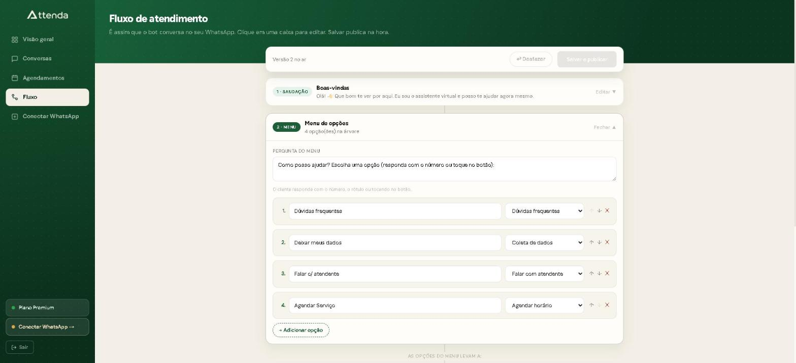

# Attenda

Plataforma de atendimento pelo WhatsApp para pequenos negócios. O cliente pode consultar serviços, escolher um horário ou pedir atendimento humano. Quem atende acompanha a agenda e o andamento das conversas em um painel.

Projeto desenvolvido em dupla com assistência de IA. Minha contribuição incluiu levantamento de requisitos, priorização de funcionalidades e validação das entregas. Este repositório reúne a apresentação pública do produto.

## Um fluxo de atendimento

O editor permite definir as opções de cada menu e o próximo passo da conversa. No exemplo abaixo, o cliente pode tirar dúvidas, atualizar dados, falar com um atendente ou agendar um serviço.

## Como o produto organiza os dados

- **Agenda.** Serviços, profissionais e disponibilidade determinam os horários oferecidos ao cliente.
- **Atendimento.** O histórico da conversa dá contexto a quem assume um atendimento manual.
- **CRM.** O painel organiza os contatos por etapa de negociação, com tarefas e notas.

A aplicação usa TypeScript e Next.js. Os registros de atendimento e agendamento ficam em PostgreSQL (Supabase), com separação por conta.

[Site do Attenda](https://attenda.tec.br)
