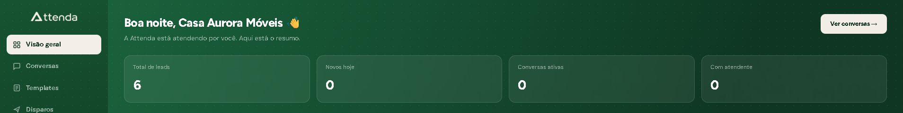
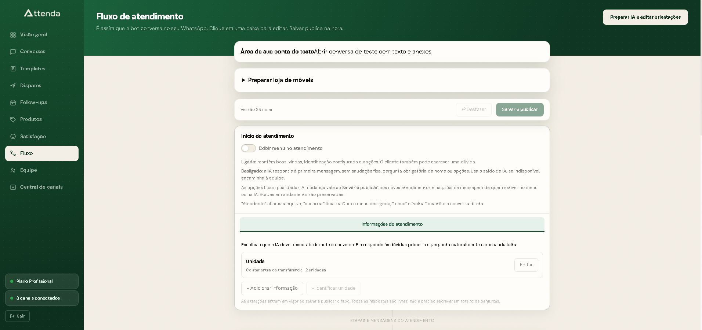

# Attenda

A Attenda é uma plataforma de atendimento, agenda e CRM para pequenos negócios. A equipe acompanha pelo painel quantos contatos chegaram, quais conversas estão ativas e quais precisam de um atendente.

## Por dentro da plataforma

As duas capturas foram feitas no painel autenticado da Casa Aurora Móveis, loja fictícia usada nos testes da Attenda.

### Visão geral

O painel distingue o total de leads dos novos leads do dia. Também mostra as conversas ativas e quantas estão com um atendente.

### Fluxo de atendimento

Nesta tela, a equipe escolhe como a conversa começa e quais informações coletar antes da transferência. No exemplo da loja de móveis, a unidade é uma das informações configuradas.

## Minha participação

Somos três no projeto. Sou responsável por toda a programação e uso IA para gerar o código. Defino como cada funcionalidade deve funcionar, testo as entregas e peço ajustes a partir do resultado. Meus dois colegas atuam principalmente no marketing.

[Site da Attenda](https://www.attenda.tec.br/)
