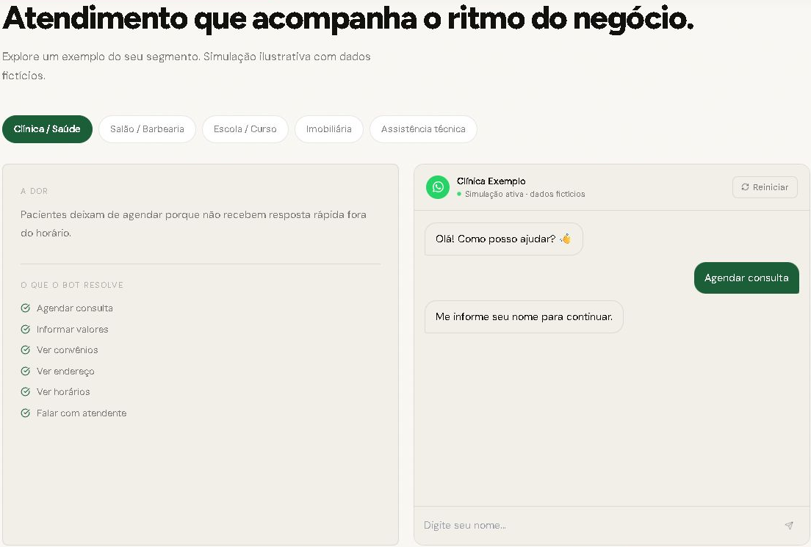

# Attenda

O Attenda reúne atendimento, agenda e CRM para pequenos negócios. Uma clínica pode oferecer opções de atendimento por mensagem, encaminhar um pedido de agendamento e manter o histórico disponível para a equipe.

[Experimentar a simulação no site](https://www.attenda.tec.br/#nichos)

## Da conversa ao agendamento

Na demonstração de clínica, o visitante escolhe “Agendar consulta” e o sistema pede o nome para continuar. A simulação usa dados fictícios. O site também apresenta exemplos para salão, escola, imobiliária e assistência técnica.

## Minha participação

Somos três no projeto. Sou responsável por toda a programação e uso IA para gerar o código. Defino como cada funcionalidade deve funcionar, testo as entregas e peço ajustes a partir do resultado. Meus dois colegas atuam principalmente no marketing.

O código da aplicação é privado. Esta página documenta o produto e uma de suas experiências públicas.
